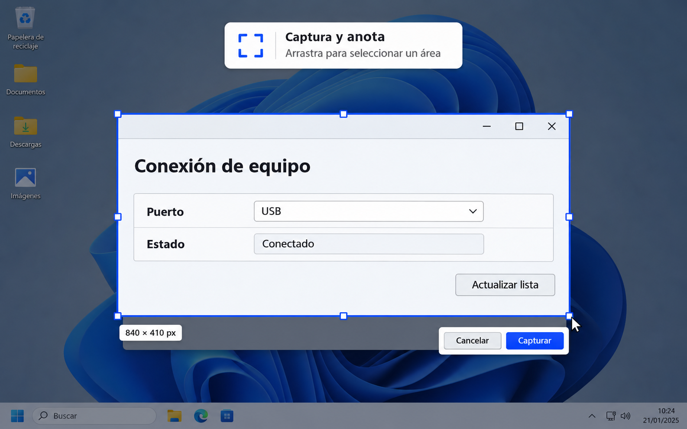

# Capture

Aplicación pequeña de escritorio para Windows que permite **capturar una zona de la pantalla y explicarla en la propia imagen con flechas y texto**. «Captura y anota» es el nombre provisional que aparece en las maquetas. El proyecto está en **fase de diseño visual**.

## Flujo de trabajo

1. **Capturar.** Arrastrar para seleccionar un área de pantalla, ajustar el recorte con los tiradores y confirmar la captura.
2. **Anotar.** Marcar una zona de la captura con un rectángulo, señalar un punto con una flecha y añadir texto explicativo. Seleccionar, mover y cambiar el color de cada anotación por separado. La maqueta propone un control de grosor para la flecha.
3. **Compartir.** La maqueta propone **Copiar** para pegar la captura anotada en otra aplicación y **Guardar** para conservarla como imagen.

## Maquetas iniciales

### Selección del área de captura

La pantalla se oscurece fuera de la selección. El marco azul tiene tiradores para ajustar el recorte antes de capturar.

### Edición de la captura

La barra superior reúne **Seleccionar**, **Rectángulo**, **Flecha** y **Texto**. El panel lateral muestra el color y el grosor de la flecha seleccionada.

Las imágenes son maquetas generadas para visualizar el flujo y usan contenido de ejemplo. La revisión del diseño precede a la implementación.
