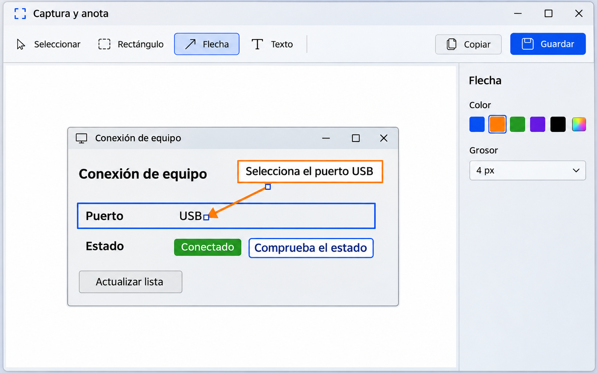

# Capture

Aplicación pequeña de escritorio para Windows que permite **capturar una zona de la pantalla y explicarla en la propia imagen con flechas y texto**. «Captura y anota» es el nombre provisional que aparece en las maquetas. El repositorio conserva las maquetas iniciales y una versión de prueba para Windows.

## Flujo de trabajo

1. **Capturar.** Arrastrar para seleccionar un área de pantalla, ajustar el recorte con los tiradores y confirmar la captura.
2. **Anotar.** Marcar una zona de la captura con un rectángulo, señalar un punto con una flecha y añadir texto explicativo. Seleccionar, mover y cambiar el color de cada anotación por separado. La maqueta propone un control de grosor para la flecha.
3. **Compartir.** La maqueta propone **Copiar** para pegar la captura anotada en otra aplicación y **Guardar** para conservarla como imagen.

## Maquetas iniciales

### Selección del área de captura

La pantalla se oscurece fuera de la selección. El marco azul tiene tiradores para ajustar el recorte antes de capturar.


### Edición de la captura

La barra superior reúne **Seleccionar**, **Rectángulo**, **Flecha** y **Texto**. El panel lateral muestra el color y el grosor de la flecha seleccionada.



Las imágenes son las maquetas iniciales del flujo y usan contenido de ejemplo.

## Versión de escritorio para Windows

Capture se ejecuta con `Capture.exe` desde una carpeta descomprimida. Usa C# 5, Windows Forms y .NET Framework 4.8, incluido en Windows 11 y en las versiones recientes de Windows 10.

1. **Captura.** Capture arranca junto al reloj. Abre la ventana que quieras recortar y pulsa **Ctrl+Alt+R**, o elige **Nueva captura** en el icono de Capture. Arrastra para elegir la zona, ajusta los bordes y confirma con **Capturar** o **Intro**. El editor se abre cuando confirmas. Pulsa **Esc** para cancelar.
2. **Anota.** Con **Flecha**, pulsa donde debe quedar la punta y arrastra para extender la línea. **Línea** dibuja un segmento sin punta. Para redimensionar una flecha o línea, arrastra sus extremos. Para redimensionar un rectángulo, arrastra sus bordes o esquinas desde los tiradores. El panel lateral permite ajustar el grosor del trazo, el tamaño de la punta y el tamaño y la negrita del texto, según la herramienta o anotación seleccionada.
3. **Comparte.** Usa **Copiar** para llevar la imagen al portapapeles o **Guardar PNG** para escribirla en un archivo. Puedes añadir también rectángulos y texto.
4. **Cierra.** La **X** de Capture y **Salir** en el área de notificación cierran el proceso y liberan el atajo. Después puedes borrar la carpeta descomprimida. Minimizar la ventana deja el atajo disponible.

Para actualizar, cierra la versión anterior con **Salir** desde su icono junto al reloj. Descomprime la nueva entrega en otra carpeta. Tus imágenes PNG siguen en la ubicación donde las guardaste. Para volver a una entrega anterior, cierra la nueva y abre la anterior desde su carpeta.

Si Windows mantiene bloqueadas las carpetas `Capture-atajo-y-linea` o `Capture-recorte-y-trazos`, guarda las anotaciones abiertas y ejecuta `Liberar-carpetas-Capture.cmd` incluido en la entrega. El comando cierra los procesos de esas dos versiones en tu sesión. Después puedes borrar las carpetas desde el Explorador.

### Compilar desde el código

Ejecuta este comando en `cmd.exe` desde la raíz del repositorio, con .NET Framework 4.8. Compila un ejecutable de interfaz gráfica e incorpora el icono y el manifiesto de DPI.

```bat
"%SystemRoot%\Microsoft.NET\Framework64\v4.0.30319\csc.exe" /nologo /langversion:5 /codepage:65001 /optimize+ /target:winexe /out:Capture.exe /win32icon:src\Capture.ico /win32manifest:src\Capture.manifest /reference:System.Windows.Forms.dll,System.Drawing.dll src\*.cs
```
